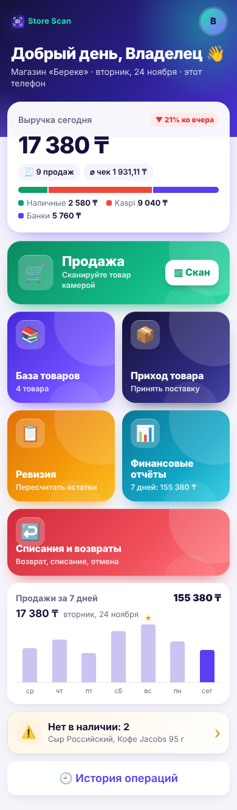
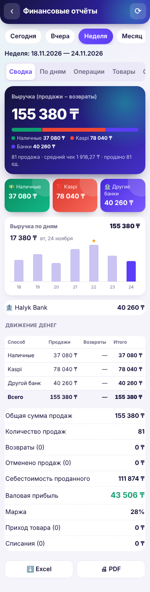

<p align="center"></p>

# Store Scan

**Сканируй. Продавай. Считай.** — мобильное приложение для учёта магазина.
Фирменный стиль: [docs/brand/BRAND.md](docs/brand/BRAND.md).

Store Scan — приложение для учёта товаров, продаж, прихода, ревизий, списаний, возвратов и кассы магазина.
Работает на **iPhone и Android** прямо в браузере и устанавливается на главный экран как обычное
приложение (PWA). Штрихкоды сканируются **камерой телефона** — отдельный сканер не нужен
(но USB/Bluetooth-сканер, если он есть, тоже работает).

## Скриншоты

<p>
 
 
</p>

## Что умеет

| Раздел | Возможности |
|---|---|
| 🛒 **Продажа** | Сканирование камерой подряд, поиск по названию, корзина, изменение количества и цены, автоматический итог, оплата наличными / Kaspi / другим банком или **частями несколькими способами** со сверкой суммы, расчёт сдачи, чек в PDF |
| 📚 **База товаров** | Название, штрихкод, категория, закупочная цена, цена продажи, остаток, единица измерения; история поступлений и продаж по каждому товару; поиск; архив; выгрузка в Excel; импорт из Excel |
| 📦 **Приход товара** | Сканирование, автопоиск товара, количество, закупочная цена, новая цена продажи; если товара нет — создание карточки прямо в приходе; история приходов с датой, количеством и суммой |
| 📋 **Ревизия** | Скан → «по базе» → ввод факта → разница. Режим «каждый скан = +1». Итоговый отчёт: недостача и излишки в штуках и деньгах (по закупочной и по продажной цене); история ревизий; выгрузка Excel/PDF |
| 📊 **Финансовые отчёты** | Сегодня / вчера / неделя / месяц / произвольный период / всё время. Продажи, количество продаж, средний чек, наличные, Kaspi, другие банки (по каждому банку), возвраты, отмены, выручка, себестоимость, валовая прибыль, приход, списания. Отчёт по дням, движение денег, движение товаров (начало → приход → продажи → возвраты → списания → ревизия → конец), остатки. Excel и PDF |
| ↩️ **Списания и возвраты** | Списание испорченного / просроченного / утерянного товара; возврат от покупателя по чеку (с контролем «не больше, чем продано») или без чека; отмена ошибочной продажи. Всё фиксируется в истории и автоматически меняет остатки |
| 🕘 **История операций** | Все операции с датой, временем, сотрудником и суммой; фильтры; детали каждой операции |
| ⚙️ **Настройки** | Сотрудники и роли, категории, список банков, импорт товаров, резервные копии |

Все разделы связаны: продажа уменьшает остаток, приход и возврат увеличивают, списание уменьшает,
ревизия исправляет остаток на фактический, отмена продажи возвращает товар на склад и убирает сумму
из отчётов. **Остаток нельзя изменить «вручную»** — только через операции, поэтому история всегда
сходится с остатками.

### Роли сотрудников

| Роль | Доступ |
|---|---|
| **Владелец** | всё, включая сотрудников и название магазина |
| **Менеджер** | товары, приход, ревизия, списания, отмена продаж, все отчёты и прибыль |
| **Кассир** | продажа, возврат, просмотр товаров, отчёт и история за сегодня |

Права проверяются **на сервере** (в базе данных), а не только в приложении.

---

## Быстрый старт: попробовать за 1 минуту

Откройте приложение и выберите **«Работать только на этом телефоне»**. Регистрация не нужна,
данные хранятся на телефоне. Это удобно, чтобы посмотреть, как всё работает.

Для работы с нескольких телефонов нужна облачная база — см. ниже.

---

## Настройка облачной базы (один раз, ~10 минут, бесплатно)

Используется [Supabase](https://supabase.com) — облачная база PostgreSQL с бесплатным тарифом.

1. Зарегистрируйтесь на supabase.com → **New project**. Регион — ближайший (например, Frankfurt).
   Запомните пароль базы.
2. Откройте **SQL Editor → New query**, вставьте всё содержимое файла
   [`supabase/schema.sql`](supabase/schema.sql) и нажмите **Run**.
   Скрипт создаёт таблицы, права доступа и функции проведения операций. Его можно запускать
   повторно — данные не удаляются.
3. **Authentication → Sign In / Providers → Email**: для простоты выключите
   **Confirm email** (иначе каждому сотруднику придётся подтверждать почту по ссылке из письма).
4. **Project Settings → API** (или **Data API / API Keys**): скопируйте **Project URL** и
   публичный ключ **anon / publishable**. (Ключ `service_role` / `secret` никому не давайте и
   в приложение не вводите!)
5. Откройте приложение → **«Подключить облачную базу»** → вставьте адрес и ключ.
6. Нажмите **«Регистрация»**. **Первый зарегистрированный пользователь становится владельцем.**

### Как добавить сотрудника

1. Сотрудник открывает приложение на своём телефоне, подключает ту же базу и регистрируется.
2. Владелец: **Настройки → Сотрудники** → выбирает роль (Кассир / Менеджер).
3. Уволенному сотруднику поставьте роль **«Заблокирован»**.

Остатки синхронизируются между всеми телефонами автоматически в реальном времени.

---

## Публикация приложения (чтобы открыть его на телефоне)

Камера в браузере работает только по защищённому адресу `https://`, поэтому приложение нужно
разместить на хостинге. Бесплатные варианты:

### Вариант А: GitHub Pages (автоматически)

1. В репозитории: **Settings → Pages → Source: GitHub Actions**.
2. (Необязательно) **Settings → Secrets and variables → Actions → Variables**: добавьте
   `VITE_SUPABASE_URL` и `VITE_SUPABASE_ANON_KEY` — тогда адрес базы будет встроен в приложение,
   и сотрудникам не нужно будет его вводить.
3. Влейте изменения в ветку `main` — приложение соберётся и опубликуется само
   (вкладка **Actions**). Адрес будет вида `https://<имя>.github.io/<репозиторий>/`.

> GitHub Pages для приватных репозиториев доступен только на платных тарифах GitHub.
> В этом случае используйте вариант Б.

### Вариант Б: Netlify / Vercel / Cloudflare Pages

Подключите репозиторий, команда сборки `npm run build`, папка `dist`.
Переменные `VITE_SUPABASE_URL` и `VITE_SUPABASE_ANON_KEY` — по желанию.
Или соберите локально (`npm ci && npm run build`) и перетащите папку `dist` на
[app.netlify.com/drop](https://app.netlify.com/drop).

### Установка на телефон

- **iPhone (Safari):** откройте адрес → кнопка «Поделиться» ⬆️ → **«На экран „Домой“»**.
- **Android (Chrome):** откройте адрес → меню ⋮ → **«Установить приложение»**.

При первом сканировании разрешите доступ к камере.

---

## Работа с приложением

**Продажа:** «Скан» → наводите камеру на штрихкоды товаров по очереди (камера не закрывается,
каждый товар с сигналом добавляется в корзину и показывается цена и остаток) → «Готово» →
при необходимости меняйте количество кнопками − / + → «Оплата» → выберите способ или
«Разделить оплату» → «Подтвердить продажу». Если штрихкод повреждён — найдите товар поиском
по названию. Корзина сохраняется, даже если случайно закрыть приложение.

**Приход:** сканируйте товары; если товара нет в базе — откроется карточка нового товара
(название, штрихкод, категория, цены, количество). Проверьте количество и цены → «Провести приход».

**Ревизия:** «Начать ревизию» → сканируйте товар → вводите фактическое количество (или режим
«каждый скан = +1» для пересчёта поштучно). Ревизию можно вести долго — данные сохраняются на
телефоне. «Завершить ревизию» исправит остатки и сохранит отчёт в истории. Опция «Полная
ревизия» обнулит товары, которые не были найдены.

**Импорт товаров из Excel:** Настройки → «Скачать шаблон», заполните его, загрузите.
Количество из файла оформится как приход.

**Резервные копии:** облачная база сохраняет каждую операцию сразу (на платных тарифах Supabase
есть ещё и ежедневные копии). Дополнительно: Настройки → «Копия (JSON)» или «Всё в Excel».

**PDF:** кнопка «PDF» открывает предпросмотр и окно печати — выберите «Сохранить как PDF»
(на iPhone: в окне печати нажмите «Поделиться» ⬆️ → «Сохранить в Файлы»).

---

## Интеграция с Kaspi и другими платёжными системами

Сейчас способ оплаты (наличные, Kaspi, конкретный банк) указывается кассиром вручную, суммы
сверяются автоматически и попадают в отчёты.

Автоматическая интеграция возможна в будущем, архитектура к этому готова (оплаты хранятся
отдельной таблицей `payments`, проведение продажи — одной серверной функцией):

- **Kaspi Pay / Kaspi QR** — API выдаётся Kaspi по партнёрскому договору (через менеджера
  Kaspi для бизнеса). После получения доступа можно добавить формирование QR на сумму продажи и
  автоматическое подтверждение оплаты.
- **Банковские POS-терминалы** (Halyk, Freedom, Forte и др.) обычно интегрируются через SDK
  банка или онлайн-кассу (ОФД); нужен договор с банком.
- **Онлайн-касса / фискальный чек (ОФД, Webkassa, Rekassa и т.п.)** — подключается через API
  выбранного сервиса.

---

## Технические детали

- **Frontend:** React + TypeScript + Vite, PWA (устанавливается, работает на весь экран,
  файлы приложения кэшируются).
- **Сканер:** встроенный в браузер `BarcodeDetector` (Android) или библиотека ZXing на
  WebAssembly (iPhone и остальные) — входит в состав приложения. Форматы: EAN-13, EAN-8, UPC,
  Code-128, Code-39, ITF, QR, DataMatrix и др. Есть фонарик (если телефон поддерживает) и ручной
  ввод кода.
- **База данных:** Supabase (PostgreSQL). Каждая операция проводится атомарно серверной функцией
  `post_operation` / `cancel_sale` с блокировкой строк товаров — одновременные продажи с разных
  телефонов не «теряют» остатки. Права — через Row Level Security. Синхронизация — Supabase
  Realtime.
- **Локальный режим:** те же правила проведения операций (`src/backend/logic.ts`), данные в
  IndexedDB телефона.
- **Экспорт:** Excel (.xlsx, несколько листов), PDF через печать браузера (полная поддержка
  кириллицы).

### Ограничения текущей версии

- В облачном режиме для проведения операций нужен интернет (мобильный интернет достаточен).
  Офлайн-очередь продаж — возможное улучшение.
- Закупочная цена скрыта от кассира в интерфейсе, но технически доступна через API базы.
- Закупочная цена товара при приходе обновляется на последнюю (не средневзвешенная).

### Разработка

```bash
npm ci
npm run dev        # http://localhost:5173 (камера работает на localhost)
npm run build      # сборка в dist/
npm run preview    # проверка собранной версии
```

Структура:

```
supabase/schema.sql        схема облачной базы, права, функции проведения операций
src/backend/               слой данных: облако (supabase.ts) и локальный режим (local.ts)
src/lib/                   типы, форматирование, отчёты, экспорт, сканер
src/components/            сканер, оплата, форма товара, общие элементы интерфейса
src/pages/                 экраны приложения
```
