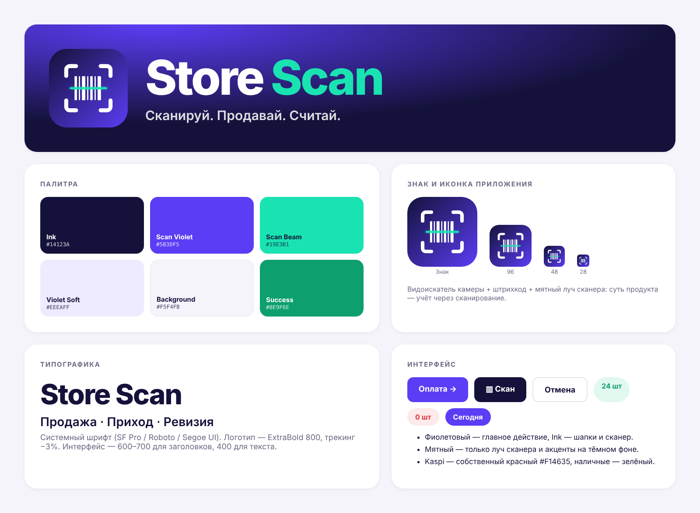

# Store Scan — фирменный стиль

## Название и слоган

- **Название:** Store Scan (всегда два слова, оба с заглавной буквы).
- **Слоган:** «Сканируй. Продавай. Считай.»
- **Описание в одну строку:** учёт товаров, продаж и кассы магазина со сканированием камерой телефона.

## Логотип

| Файл | Назначение |
|---|---|
| [`logo-mark.svg`](logo-mark.svg) | Знак (иконка) — аватарки, соцсети, иконка приложения |
| [`logo-horizontal.svg`](logo-horizontal.svg) | Горизонтальный логотип со словесным знаком — сайт, документы, вывески |
| `public/icon-192.png`, `icon-512.png` | Иконки приложения |
| `public/icon-maskable-512.png` | Иконка Android с безопасной зоной |
| `public/apple-touch-icon.png` | Иконка iPhone |

**Идея знака:** уголки видоискателя камеры + штрихкод + мятный луч сканера. Знак сразу говорит,
что приложение работает через сканирование камерой.

**Правила:**
- Вокруг логотипа — свободное поле не меньше высоты штрихкода.
- Минимальный размер знака — 24 px.
- Не менять цвета знака, не растягивать, не добавлять тени и обводки.
- На тёмном фоне слово «Scan» мятное (#19E3B1), на светлом — фиолетовое (#5B3DF5).

## Цвета

| Цвет | HEX | Где используется |
|---|---|---|
| **Ink** | `#14123A` | Шапки экранов, сканер, тёмный фон, основной текст |
| **Scan Violet** | `#5B3DF5` | Главные кнопки, активные элементы, ссылки |
| **Scan Beam** | `#19E3B1` | Луч сканера, акценты на тёмном фоне (не для текста на белом) |
| Violet Soft | `#EEEAFF` | Подсветка, подсказки, выделенные блоки |
| Background | `#F5F4FB` | Фон приложения |
| Success | `#0E9F6E` | Наличные, «в наличии», успешные операции |
| Danger | `#E0353B` | Недостача, ошибки, удаление |
| Warning | `#E8890C` | Предупреждения, мало на складе |
| Kaspi | `#F14635` | Только для способа оплаты Kaspi |

Градиент бренда: `Ink → Scan Violet` под углом 135°.

## Шрифты

Системный шрифт телефона (SF Pro на iPhone, Roboto на Android): быстро загружается и хорошо
читается. Логотип — ExtraBold (800), межбуквенный интервал −3 %. Заголовки — 600–700, текст — 400.

## Тон общения

Коротко, по делу, на «вы» в инструкциях и повелительным наклонением на кнопках:
«Сканировать», «Провести приход», «Подтвердить продажу». Без канцелярита и технических терминов.
